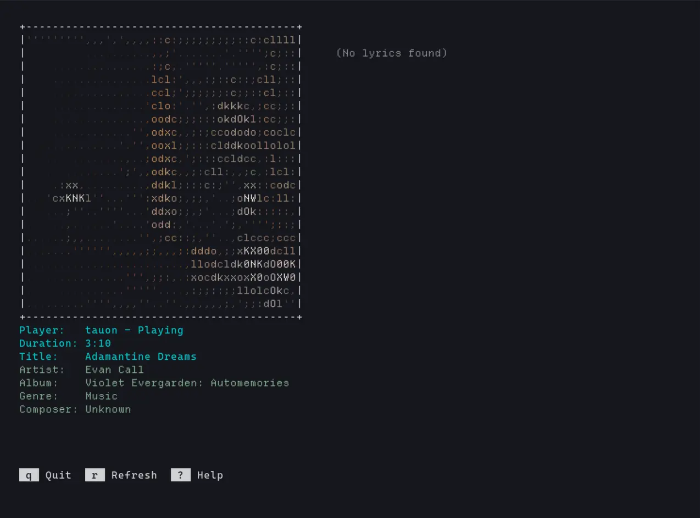

# yams



Yet another media screensaver.
> Or status indicator

`playerctl` wrapper go brr.

## Features

- CJK/Unicode Support (`ncursesw`)
- Currently Playing Media (`playerctl`)
  - Metadata (Media name/title/etc.)
  - ASCII art (extracted from audio file/URL)
  - Lyrics (if available)
  - Play/Pause Next/Previous
- Help Menu for keybinds
- Refresh Button (if auto-refresh/polling does not work)

## Planned

- Rendering layout for smaller screens

## Known Issues

Needs programme restart.
- Fallback mode check not triggered by refresh hotkey.

When opened in tmux, switching focus away and then back means programme can only
exit with `Ctrl + C` instead of `q`.

## Tested Media Players

- mpv (requires mpv-mpris)
- YouTube Web
- YouTube Music Web
- Tauon

- Firefox-based browser(s)

Should work with media players detectable by `playerctl` or those that implement
`mpris`.

> PRs welcome to add tested media player entries.

## Requirements

### Core Dependencies

Built on the shoulders of giants.

- ncurses (TUI)
- [playerctl](https://github.com/altdesktop/playerctl)
- ffmpeg (Extract image thumbnail from audio file)
- imagemagick (Convert to WEBP, used so jp2a handles image scaling better)
- jp2a (JPG/WEBP to ASCII)
- sed (Regex replace)

### Dev Dependencies

- GNU Make
- meson
- ninja

## Platform support

Linux.

## Setup

Clone the repository, ensure you have listed dependencies on your system.

```bash
git clone --depth=1 https://codeberg.org/bladeacer/yams.git
```

- Use `make install` to install binary to `/usr/local/bin`.

- Use `make release` to install stripped binary to `./build/yams`.

- Use `make run` to install binary with debug to `./build/yams`.

### Binary size comparison

| `make` flag | Binary size |
| --- | --- |
| `make install` | ~ 30 kB |
| `make release` | ~ 36 kB |
| `make run` | ~ 70 kB |

## LLM Usage Disclaimer

I used LLMs to help with development.

This is my first project using `ncurses`, C and UNIX tools like `strace`, `stat`.

## License

Dual licensed under either the MIT or Apache-2.0 License, at your own choice.
