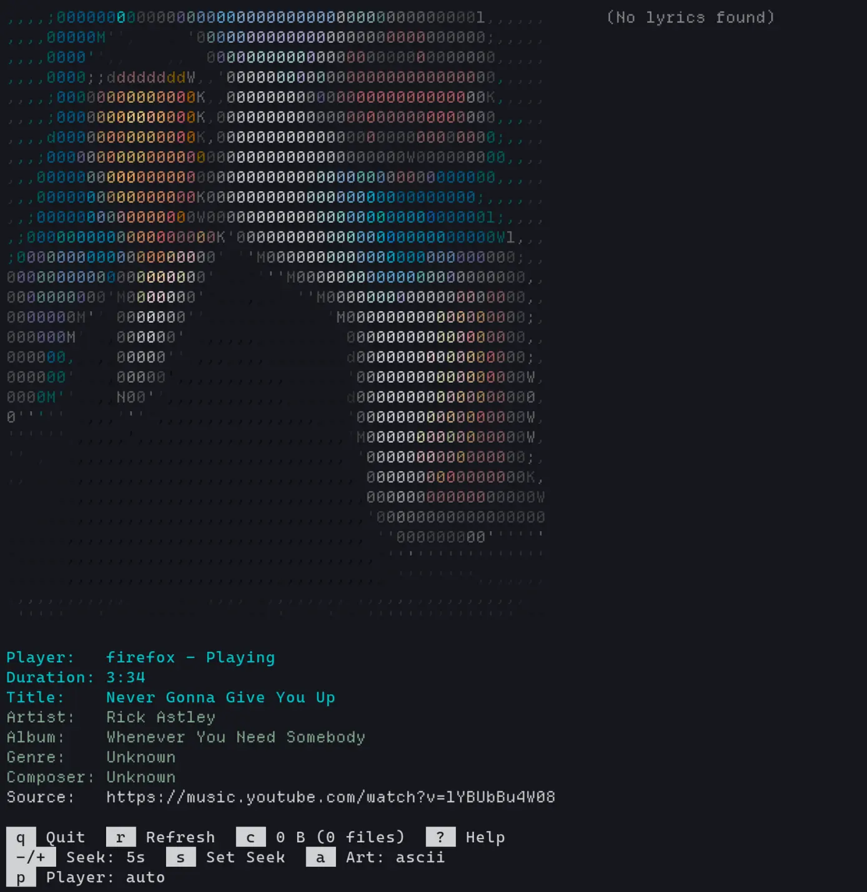
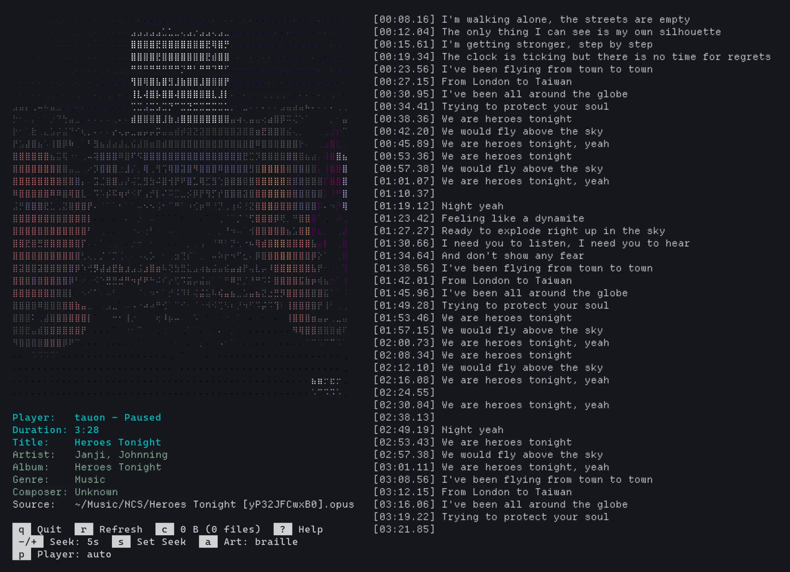
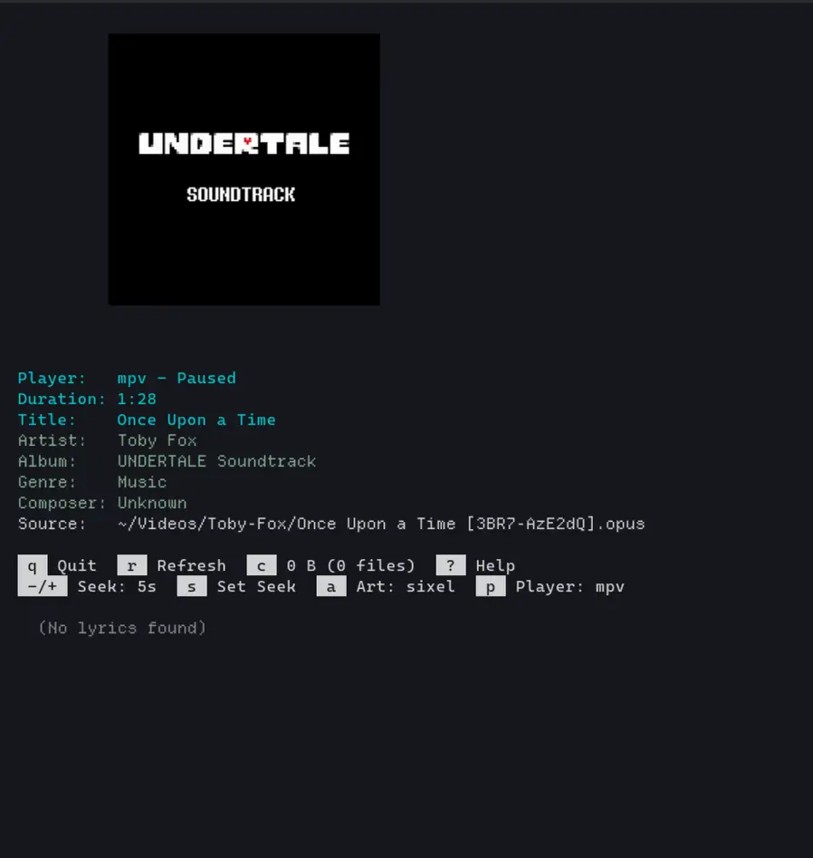

# yams

yams (yet another media screensaver) is a media screensaver that displays
MPRIS metadata and album art (ASCII/braille/sixel/others) in the terminal.

## Screenshots

| Art Mode | Preview |
| --- | --- |
| [ASCII Preview](preview_ascii.webp): Never Gonna Give You Up by Rick Astley  |  |
| [Braille Preview](preview_braille.webp): Heroes Tonight by Janji and Johnning (NCS)  |  |
| [Sixel Preview](preview_sixel.webp): Once Upon a Time by Toby Fox |  |

## Features

### Interface

- Album art (`a`): ASCII/braille/sixel rendering (requires sixel-capable terminal).
Press `a` to configure available options.

- Help (`?`): help menu with keyboard shortcut mappings shown.

- Refresh (`r`): force immediate art retry and re-render

- Unicode/CJK support: Unicode/CJK support (via `ncurses`,
depends on active system fonts).

- Fallback/Adaptive UI: Automatic layout handling on terminal resize, fallback UI
 when no players are detected.

- Status feedback, fallback text where necessary.

### Media

- Get metadata from MPRIS-compliant players (via `playerctl`)
  - Includes title, artist, album, composer, genre, length, path, art, lyrics

- Media Playback controls:
  - Play/Pause (`Spacebar`)
  - Previous/Next(`h/l`)
  - Seek forward/backward (`j/k`, configure interval with `+/-` or `s`)

- Remote album art caching: Cached art is stored locally under `~/.cache/yams/art/`

- Auto-retry failed downloads: Auto-retries remote art downloads at increasing intervals

- Cache management: Clear art cache (`c`), view cache size

- Player selector (`p`): switch between multiple playerctl players at runtime;
metadata/art/lyrics update immediately

## Quick Start

```bash
git clone --depth=1 https://codeberg.org/bladeacer/yams.git
cd yams
sudo make install
yams
```

Refer to [dependencies](#dependencies) for platform specific dependency installation
and details.

**`make install` will fail without the required dependencies.**

## Nix

If you have Nix installed with Flakes enabled, you can build or run **yams**
without manual dependency setup

```bash
git clone --depth=1 https://codeberg.org/bladeacer/yams.git
cd yams
nix run

# Build yams (binary will be in ./result/bin/yams)
nix build

# Enter a development shell with all tools (valgrind, meson, etc.)
nix develop
```

Note: This is not tested, Nix users do let me know if it works (or fails).

## Dependencies

### Core

- ncursesw (TUI, wide char support)
- panelw (ncurses panel library)
- [playerctl](https://github.com/altdesktop/playerctl) (MPRIS D-Bus controller)
- [ffmpeg](https://ffmpeg.org/) (libavformat/libavcodec/libswscale/libavutil, image decoding)
- [chafa](https://hpjansson.org/chafa/) >= 1.18.2 (image to ASCII/braille/sixel conversion)
- glib (chafa dependency)

### Build

- Git, GNU Make, [meson](https://mesonbuild.com/),
[ninja](https://ninja-build.org/), awk, util-linux (for script), procps (for pgrep/ps)

### Test

- [cmocka](https://cmocka.org/) (meson falls back to a bundled subproject if not found)


### Linux

**Debian/Ubuntu**
```bash
sudo apt install libncursesw6 libncurses-dev libpanelw6 libpanel-dev \
  playerctl libavformat-dev libavcodec-dev libswscale-dev libavutil-dev \
  chafa libchafa-dev libglib2.0-dev meson ninja-build cmocka \
  bsdutils procps valgrind
```

**Arch**
```bash
sudo pacman -S ncurses playerctl ffmpeg chafa glib2 meson ninja cmocka util-linux procps valgrind
```

**Fedora**
```bash
sudo dnf install ncurses-devel playerctl ffmpeg-devel chafa-devel \
  glib2-devel meson ninja-build cmocka-devel util-linux procps-ng valgrind
```

### macOS (Homebrew)

```bash
brew install ncurses playerctl ffmpeg chafa glib meson ninja cmocka
```

Note: yams requires an MPRIS-compatible player.

While the code probably compiles on macOS, you may need a D-Bus bridge to
control macOS media players.

Valgrind might take a fair bit of setup.

Use leaks (built-in) or compile with -fsanitize=address for memory debugging.

## Build Targets

| Command | Binary | Linkage | Use case |
| --- | --- | --- | --- |
| `make install` | `/usr/local/bin/yams` | static | Install system-wide |
| `make install-dynamic` | `/usr/local/bin/yams` | dynamic | Install system-wide |
| `make run` | `./build/yams` | dynamic | Development, run in place |
| `make release` | `./build/yams` | static | Stripped portable binary |
| `make release-dynamic` | `./build/yams` | dynamic | Stripped dynamic binary |
| `make test` | N/A | dynamic | Build and run unit tests |

Static builds link all dependencies (chafa, ffmpeg, glib, ncursesw, panelw)
directly into the binary. Static library variants (`.a` files) are required.

## Development

```bash
make run              # debug build, run in place
make test             # build + run unit tests
make release          # stripped static binary
make build            # compile only (no run, no install)
make valgrind         # run under valgrind for memory leak detection
ninja -C build test   # run tests after build (cmocka default output)
```

### Test (dev dependencies)

- [cmocka](https://cmocka.org/) (meson falls back to a bundled subproject if not found)
- valgrind

> Development utilizes Valgrind for memory profiling.
> This tool is required only for testing and is not a runtime dependency
> or a bundled component of the software.

cmocka is optional; meson will fetch and build it as a subproject if not found system-wide.

## Known Issues

- When opened in tmux, switching focus away and back means the program can only
exit with `Ctrl+C` instead of `q`.

- Rendered Sixel art feels small at larger screen resolution

- When new lyrics are loaded/switching between, a media next + previous is
required for it to see the new lyrics.

- Last active player does not auto update itself automatically after setting
target player and switching back to auto.

## Tested Media Players

- mpv (requires mpv-mpris)
- YouTube Web / YouTube Music Web
- Tauon
- Firefox-based browsers

Should work with any other MPRIS-compliant media players.

## Contributing

PRs are welcome to add tested media player entries, cleaning up/improving parts
of the codebase.

## Planned

- Fixes for remaining known issues
- Configuration file
- More flexible/modular directory conventions for macOS

## LLM Usage Disclaimer

I used LLMs to help with development. This is my first project using ncurses,
C, UNIX tools like strace and going somewhat low-level.

## Credits

[hrtowii](https://github.com/hrtowii) for testing and helping with development.

## License

Dual licensed under either the MIT or Apache-2.0 License, at your own choice.
